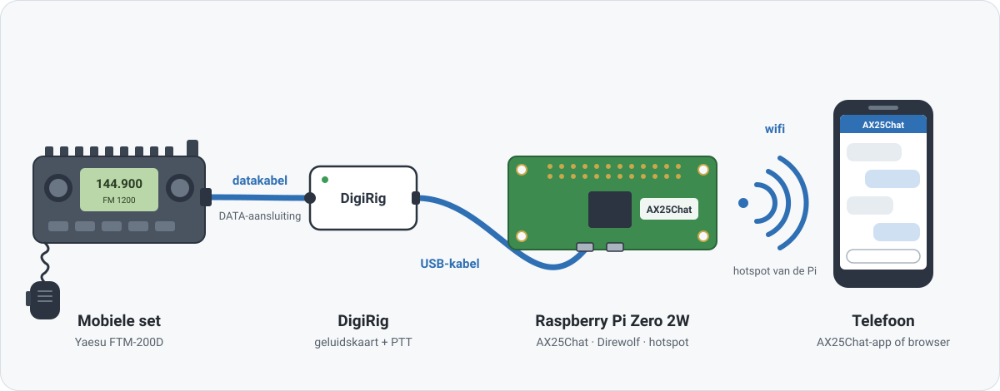

# AX25Chat

Chatten via **AX.25 packetradio** met je telefoon of laptop. Je typt een bericht, een Raspberry Pi
met **Direwolf** maakt er packet-geluid van en je set zendt het uit. Wat binnenkomt, lees je weer
op je scherm.

```
telefoon / laptop ──wifi──► RASPBERRY PI (hotspot 10.42.0.1) ──USB──► SET ──► 2 m
                             webserver · Direwolf · rigctld
```

Onderweg met een Baofeng UV-5R, een DigiRig, een Pi Zero 2W en je telefoon, of in de shack met een
IC-9700, IC-7300 of FT-818. Eén set tegelijk, één gebruiker per Pi. Op de amateurband gaat niets
versleuteld: berichten gaan als gewone, leesbare tekst.



**Stand van zaken:** stap 1 (de Pi en de set: hotspot, Direwolf, CAT, Zoek mijn set) en stap 2 (chatten:
berichten met bevestiging, CQ roepen, monitor) zijn klaar om te testen. Stap 3 (webapp voor telefoon en
laptop, later ook een Android-app) volgt. Connected mode is begonnen: op het tabblad BBS verbind je met een
bestaande BBS (AX25Chat is zelf geen BBS).

## Hoe het chatten werkt

Berichten gaan als **APRS-bericht** de lucht in, als gewone tekst. Zo kunnen ook APRSdroid, Kenwood- en
Yaesu-sets en andere APRS-stations ze lezen en beantwoorden:

```
PD3PAM-7>APZAXC::PA1ABC-9 :Hoi, hoor je me?{12      bericht aan PA1ABC-9 (nummer 12)
PA1ABC-9>APZAXC::PD3PAM-7 :ack12                     bevestiging terug
PD3PAM-7>APZAXC::CQ       :CQ CQ de PD3PAM           aan iedereen, zonder bevestiging
```

Een bericht aan een station wordt herhaald tot de bevestiging binnen is (hoogstens 5 keer, in ongeveer
6 minuten). Met **Stop** breek je dat eerder af. Langer dan 67 tekens wordt opgesplitst. Alles wat de Pi verder hoort, staat in de **Monitor**.

**APRS-baken alleen met CAT:** het baken zendt altijd op 144,800. Staat je set op een andere frequentie (bijv.
144,925 om te chatten), dan zet de Pi hem even op 144,800 en daarna terug. Dat kan alleen als de Pi de set via **CAT**
kan bedienen. Een set zonder CAT, zoals de **Baofeng UV-5R** of de **Motorola GM-340** met een DigiRig, stel je met
de hand in: daarmee kun je het baken niet naast het chatten aanzetten. Het baken zendt dan alleen als je de set zelf
op 144,800 zet en bij Station ook 144,800 kiest (je chat dan ook op 144,800). Zie
[docs/PROCEDURE.md](docs/PROCEDURE.md#aprs-baken-je-positie-op-de-kaart).

Op het tabblad **Kaart** staan de stations die je hoort met een APRS-positie, op een offline kaart van
Nederland (PDOK). Nodes en BBS'en zonder APRS-positie staan er ook op als hun locator bekend is (uit hun baken,
of zelf ingevuld), met een eigen symbool op het midden van het locatorvak. Die download je eenmalig met internet op het tabblad Radio; daarna werkt hij zonder internet.

**Android-app:** voor dagelijks gebruik (chat met meldingen, kaart, BBS). Download de APK bij
[Releases](https://github.com/ieddev/AX25Chat/releases); uitleg in [docs/PROCEDURE.md](docs/PROCEDURE.md#android-app).
De broncode staat in `android/`.

## Installeren

1. Zet met de **Raspberry Pi Imager** *Raspberry Pi OS Lite (64-bit)* op een SD-kaart.
   Bij *OS-instellingen bewerken*: een gebruiker, SSH aan, je wifi, tijdzone Europe/Amsterdam.
2. Start de Pi, log in (`ssh <gebruiker>@<naam>.local`) en typ:

```bash
bash <(curl -sL https://raw.githubusercontent.com/ieddev/AX25Chat/main/installeer.sh)
```

3. Beantwoord de vragen (roepnaam met SSID, wachtwoorden) en herstart.
4. Verbind je telefoon met de wifi **AX25Chat-&lt;roepnaam&gt;** en open **http://10.42.0.1**.
   Op het tabblad **Radio** (gebruiker *beheer*): **Zoek mijn set**, daarna de **luistertest** en een
   **testuitzending**.

Bijwerken: tabblad **Status**, *AX25Chat bijwerken*. Een Pi Zero zet daarvoor even de hotspot uit en gaat via je
thuis-wifi; daarna komt de hotspot vanzelf terug. Of via ssh: `ax25chat-bijwerken`. Instellingen blijven bewaard.

**Zonder Pi, op een Linux-PC** (testfase), in een eigen programmavenster:

```bash
bash <(curl -sL https://raw.githubusercontent.com/ieddev/AX25Chat/main/installatie/linux/installeer.sh)
```

Daarna staat **AX25Chat** in het menu. Zie *AX25Chat op een PC* in de procedure.

**Op Windows** (testfase): download `AX25Chat-setup-<versie>.exe` bij de nieuwste `win-v`-release. Zie *AX25Chat op Windows* in de procedure.

De volledige procedure, met per set waar je op moet letten, staat in [docs/PROCEDURE.md](docs/PROCEDURE.md).
Om te printen of offline te lezen: [docs/AX25Chat-handleiding.pdf](docs/AX25Chat-handleiding.pdf) (README, procedure en
testplan in één PDF, stand 26-11-2026).

## Testen

Zie [docs/TESTPLAN.md](docs/TESTPLAN.md): scenario's per set voor installatie, Zoek mijn set,
frequentie, luistertest en testuitzending.

De code zelf testen, zonder hardware: `python3 -m unittest discover -s tests`.
Is Hamlib geïnstalleerd (`rigctld`), dan wordt ook het zetten van de mode op een nagebootste IC-9700 getest.

## Inhoud

| Map | Wat |
|---|---|
| `installeer.sh` | Installeert en werkt bij |
| `gemeenschappelijk/` | Set en modem: Zoek mijn set, CAT (rigctld), Direwolf, USB-herkenning, AX.25/KISS, hotspot, diensten |
| `chat/` | De chat (APRS-berichten, bevestigen, herhalen, monitor), de chatpagina en de webserver (tabbladen Chat, Radio en Status) |
| `pc/` | AX25Chat op een gewone PC zonder Pi: eigen venster (`ax25chat_venster.py`) of in de browser (`ax25chat_pc.py`) |
| `installatie/windows/` | Inno Setup-script voor de Windows-installer (gebouwd door GitHub Actions) |
| `installatie/linux/` | Installeert en werkt bij op een Linux-PC (Debian/Ubuntu), met snelkoppeling in het menu |
| `docs/` | Procedure en testplan, ook samen met deze README als PDF (`AX25Chat-handleiding.pdf`) |
| `tests/` | Tests zonder hardware (nagebootste USB-sets) |

## Licentie en openheid

AX25Chat is open en blijft open. Wat geldt voor welk deel:

| Deel | Licentie |
|---|---|
| De AX25Chat-code (installatie, webserver, scripts) | [EUPL-1.2](LICENSE), de open-sourcelicentie van de Europese Unie, ook officieel in het Nederlands |
| `docs/` (procedure, testplan) | [CC BY-SA 4.0](docs/LICENSE) |

Iedereen mag AX25Chat gebruiken, aanpassen en doorgeven. Wie een aangepaste versie verspreidt, geeft de
broncode daarvan ook vrij, onder dezelfde licentie.

### Waar AX25Chat op voortbouwt

- [Noodnet](https://github.com/ieddev/noodnet) (EUPL-1.2): de hotspot, Direwolf, CAT en Zoek mijn set komen
  daaruit.
- [Direwolf](https://github.com/wb2osz/direwolf) (GPL-2.0) en [Hamlib](https://hamlib.github.io) (LGPL/GPL).
  Die worden bij de installatie uit de gewone pakketbronnen gehaald.

### Hoe AX25Chat gemaakt is

Gert de Haan, PD3PAM, heeft AX25Chat ontworpen, de keuzes gemaakt en test alles in de praktijk op echte
sets en Raspberry Pi's. Een groot deel van de code en documentatie is in samenwerking met een
AI-assistent (Claude, van Anthropic) geschreven. Elke wijziging wordt door hem beoordeeld en getest.
